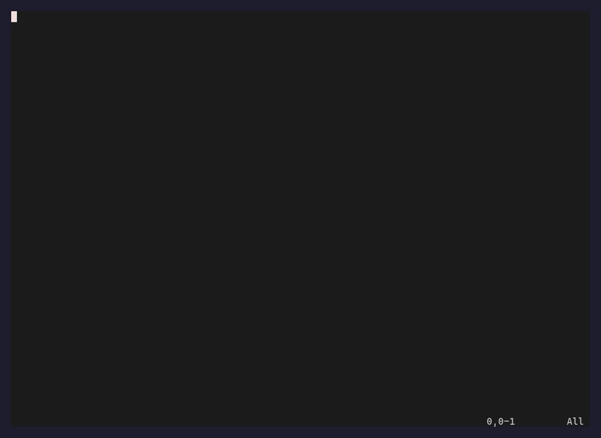

# bsh.nvim

**Buffer SHell**: a shell that lives in a Neovim buffer instead of a terminal.



Write `% command` on a line and press `<CR>`. bsh runs it and puts the output in
an `out` fence right below. Run it again and that fence is replaced, not
duplicated. The whole session is an ordinary buffer: search it, fold it, edit
the output in place, and save it as a file you can share or re-run later.

> [!WARNING]
> Experimental. Most of this was written with AI assistance and hasn't had a
> careful human review yet. Expect rough edges, and don't point it at anything
> you can't afford to break.

## Quick start

```lua
-- lazy.nvim
{ "mktip/bsh.nvim", opts = {} }
```

Then open any `notes.bsh` or `notes.bsh.md` file (or run `:Bsh` for a scratch
buffer, `:Bsh!` to turn the current buffer into one), and type:

```
% uname -a
```

Put the cursor on it and press `<CR>`. For a guided tour, open
[`examples/playground.bsh`](examples/playground.bsh).

## Cells

A cell is a line (or a fenced block) that bsh knows how to run.

| Cell | What it does |
|------|--------------|
| `% cmd` | run once in a fresh shell, output in an `out` fence below |
| `%% cmd` | run in the buffer's persistent shell: `cd`, `export`, venvs carry over |
| `user@host% cmd` | the same over ssh (`user@host%% cmd` for a persistent remote shell) |
| `docker@id% cmd` | inside a container (any transport you define, see below) |
| ` ```%% ` … ` ``` ` | a multiline shell block; `<CR>` anywhere inside runs it |
| ` ```python % ` / ` ```python %% ` | Python, one-shot or a persistent interpreter (remote too: ` ```python user@host%% `) |
| `: path` | list a directory; `<CR>` on an entry drills in or opens the file |
| `: path -T` / `-H` | a foldable tree / include dotfiles |
| `: goto query` | fuzzy-jump to a directory under `$HOME` (needs `fd` + `fzf`), then list it |
| `user@host: path` | the same, on a remote machine |
| `> question` | ask an AI agent, no memory (see [Agent cells](#agent-cells)) |
| `>> question` | ask in this file's ongoing conversation |
| `https://…` | open the URL in your browser |
| `name.space` | run a script from your `$BSH_HOME` (see [Your own commands](#your-own-commands)) |

Lines that aren't cells are just text: write notes between them. Output streams
in live, and every result fence folds to a one-line summary (`za`).

**The buffer is your history.** To run something again, scroll up (or `[c`),
edit the cell and press `<CR>`: its old result is replaced in place. Output is
ordinary text you can edit too, but a re-run overwrites it. Inline output stops
after 2000 lines (`output_max_lines`); use `g<CR>` for anything bigger.

## Keys

| Key | Action |
|-----|--------|
| `<CR>` | run the cell under the cursor (output inline) |
| `g<CR>` / `<C-CR>` | run it, sending output to a side buffer (for long logs, `tail -f`, servers); the cell keeps a `log` link, `<CR>` on it opens the buffer |
| `<C-c>` | cancel the running cell (a session cell is interrupted; the session survives) |
| `<C-k>` | reset the session under the cursor (fresh shell / interpreter) |
| `<localleader>r` | replay a session from the top down to the cursor, in a fresh interpreter |
| `<localleader>t` | hide / show the agent's thinking lines |
| visual `<CR>` | when the selection ends on a `>` cell, ask it with the selected lines attached |
| `<M-CR>` (Alt+Enter) | run the cell, then start the next one (same `%`, `user@host%%`, `>>` prefix) a blank line below its output |
| `]c` / `[c` | jump to the next / previous cell |
| `io` / `ao` | text objects for a cell's output (body / whole fence): `yio` copies it, even when folded; `dao` deletes it |

Commands: `:Bsh[!]`, `:BshCancel`, `:BshReset[!]` (`!` = every session in the
buffer), `:BshReplay`, `:BshThinking`, `:BshForget`. See `:h bsh` for details.

> `<C-CR>` only reaches Neovim in terminals that speak the kitty keyboard
> protocol (kitty, foot, WezTerm, Ghostty...). `g<CR>` always works.

## Remote machines and containers

The part before the marker is a **route**. A bare `host` or `user@host` is ssh
(your `~/.ssh/config` aliases work). Anything else is a `scheme@addr` hop whose
scheme you define, and hops chain with `/`:

```
me@server% uname -a              # ssh
docker@api% ps aux               # docker exec (podman@api for podman)
docker@api%% cd /srv             # a persistent shell inside the container
me@server/docker@api% ps aux     # ssh to server, then into its container
me@server: /var/log              # list a remote directory
```

Long routes get an alias:

```lua
require("bsh").setup({ routes = { box = "me@server", api = "box/podman@api" } })
```

Then `api%% ps` runs in that container, and `box/docker@db% ls` works too.

**Make remote cells fast.** Each `%` opens a new ssh connection. Let ssh reuse
one, and remote cells feel local:

```
# ~/.ssh/config
Host *
  ControlMaster auto
  ControlPath ~/.ssh/cm-%r@%h:%p
  ControlPersist 10m
```

`<CR>` on a file in a remote listing opens it as a `bsh://<route>:<path>`
buffer, read and written (`:w`) over the same route. So you can edit a config
file inside a container on another machine just like a local one.

ssh, `docker@` and `podman@` work out of the box. Add your own as argv
templates with `{addr}` and `{cmd}` holes:

```lua
require("bsh").setup({
  transports = {
    jail   = { "jexec", "{addr}", "sh", "-lc", "{cmd}" },
    kube   = { "kubectl", "exec", "-i", "{addr}", "--", "sh", "-lc", "{cmd}" },
  },
})
```

## Agent cells

`> question` runs a headless agent and writes its reply into an `agent` fence.
It uses [pi](https://pi.dev) when it's installed, otherwise the
[`llm`](https://llm.datasette.com/) CLI.

- `>` has no memory: it sees only the question.
- `>>` continues this file's conversation. With pi, the conversation is
  remembered by pi itself (keyed to the file path), so deleting cells doesn't
  make it forget; `:BshForget` starts a new one. With `llm`, or with
  `agent_thread = "document"`, `>>` instead re-reads the cells above it, back to
  the nearest `>`, heading or `---`.
- The agent is read-only by default: it can read and search files itself, and
  for anything else it suggests a command for you to run. End the arrows with
  `!` (`>!`, `>>!`) to let it run commands and edit files.
- Tool calls show up as `[tool] arg` lines and thinking as `| ` lines (hide them
  with `<localleader>t`).
- `[model]> question` picks a model (pi) or template (llm).
- To hand it part of the file, visually select the lines ending on the `>` cell
  and press `<CR>`.

## Your own commands

Point `$BSH_HOME` at a directory (default `~/.config/bsh`) and its tree becomes a
dotted command namespace: `git.undo` runs `$BSH_HOME/git/undo`. Any executable
works; it's run by its shebang, so the extension doesn't matter.

```
demo.weather Ankara | tr a-z A-Z    # args, pipes and redirects work
demo.                               # list a folder as a navigable menu
demo.weather!                       # open its source (or scaffold a new command)
```

A command can talk back to bsh through its exit code:

- **exit 150**: its output is a **menu**. `<CR>` on a line re-runs the command
  with that line appended as an argument, so a script can be drilled into.
- **exit 151**: its first line is a **new cell** that replaces the trigger, e.g.
  a container picker that hands you a `docker@<id>%% ` shell.

[`examples/bsh-home`](examples/bsh-home) has small examples of each, plus two
pickers: `ssh` lists the hosts from your ssh config and history, and
`containers` lists running podman/docker containers, here or on a host
(`containers me@server`). `<CR>` on an entry gives you a `%%` session cell in it. Try them with
`export BSH_HOME=/path/to/bsh.nvim/examples/bsh-home`.

`bin/bsh` resolves the same names from any shell (`bsh git.undo`), running in
*your* current directory. Put it on your `PATH` to use your commands in `%%`
sessions, a normal terminal or over ssh.

## Your own cell kinds

Every line is matched against an ordered list of rules, first match wins (think
Plan 9's plumber). You can put your own in front of the built-in ones. A rule is
a Lua pattern plus a function that gets its captures. Return a shell command to
run it like a `%` cell, or handle the line yourself:

```lua
require("bsh").setup({
  rules = {
    -- `PROJ-123` on its own line opens the ticket
    { match = "^%s*(%u+%-%d+)%s*$", run = function(_, id)
        vim.ui.open("https://jira.example.com/browse/" .. id) end },
    -- `man ls` shows the page, output inline
    { match = "^man (%S+)$", run = function(_, page) return "man " .. page .. " | col -b" end },
  },
})
```

Return `false` to let the line fall through to the built-in rules.

## Install

Requires **Neovim 0.10+** and a POSIX shell. Everything else is optional:

| For | Install |
|-----|---------|
| Python cells | `python3` (`config.python` picks another) |
| Agent cells | [pi](https://pi.dev) or [`llm`](https://llm.datasette.com/) |
| `: goto` | [`fd`](https://github.com/sharkdp/fd) and [`fzf`](https://github.com/junegunn/fzf) |
| LSP inside ` ```python ` fences | [otter.nvim](https://github.com/jmbuhr/otter.nvim) (picked up automatically) |

Run `:checkhealth bsh` to see what's available.

With lazy.nvim, use the spec from [Quick start](#quick-start). With any other
plugin manager, add the repo to your runtimepath; the plugin sets itself up and
`setup()` is only needed to change options.

bsh attaches to `*.bsh` (its own filetype) and `*.bsh.md` / `*.bsh.markdown`
(which stay markdown, so they render nicely on GitHub).

## Configuration

Defaults shown; pass only what you want to change:

```lua
require("bsh").setup({
  marker = "%",             -- the run marker; "$" if you prefer
  remote_login = true,      -- remote cells run in a login shell (loads profile/bashrc)
  transports = {            -- besides ssh; yours are merged in
    docker = { "docker", "exec", "-i", "{addr}", "sh", "-lc", "{cmd}" },
    podman = { "podman", "exec", "-i", "{addr}", "sh", "-lc", "{cmd}" },
  },
  routes = {},              -- route aliases: { box = "me@server", api = "box/podman@api" }
  python = "python3",
  output_max_lines = 2000,  -- inline output cap (false = none); g<CR> has no cap
  agent = "auto",           -- "pi", "llm" or "auto" (pi if installed)
  agent_thread = "session", -- or "document": `>>` re-reads the cells above it
  agent_tools = "read,grep,find,ls",                         -- pi, for `>`
  agent_tools_write = "read,grep,find,ls,bash,edit,write",   -- pi, for `>!`
  agent_thinking = false,   -- pi --thinking level: "low", "high", ...
  agent_show_thinking = true,
  agent_hide_thinking = false,  -- start with thinking folded away
  otter = "auto",           -- LSP in python fences when otter.nvim is installed
})
```

All options are documented in [`lua/bsh/config.lua`](lua/bsh/config.lua) and
`:h bsh-config`.

## Limitations

- No interactive programs: anything that needs a TTY (`vim`, `htop`, password
  prompts, `ssh` asking for a passphrase) won't work. Use key-based ssh auth.
- No shell history or tab completion, at least for now. The buffer is your
  history (see [Cells](#cells)).

## Motive

I'm frustrated with how uneditable the regular shell interface is, and how one
must rely on terminal creators to support any form of interaction with shell
output (highlighting URLs, searching output, scrolling). What if my shell was a
Neovim buffer, where I can search, edit, and do all the Neovim magic my heart
desires? I want to edit my terminal window however I like, and that's what this
project gives me. (Although I do lose interactive commands, shell history, and
many other things. Hopefully temporarily.)

A side benefit: sessions are plain `.bsh.md` files, so I can share them as
markdown.

## Development

```sh
make test   # headless mini.test suite; fetches mini.nvim into deps/ on first run
```

The demo GIF is recorded with [VHS](https://github.com/charmbracelet/vhs):
`vhs assets/vhs/showcase.tape`.

## Roadmap

- More language drivers beyond Python (Ruby next), and a generic way to add them
- A cleaner protocol for menus and commands than exit codes
- A proper human review of the code

## Credits

Inspired by [Xiki](https://youtu.be/bUR_eUVcABg),
[Plan 9](https://en.wikipedia.org/wiki/Plan_9_from_Bell_Labs) and Emacs nerds
everywhere.

## License

[AGPL-3.0](LICENSE).
