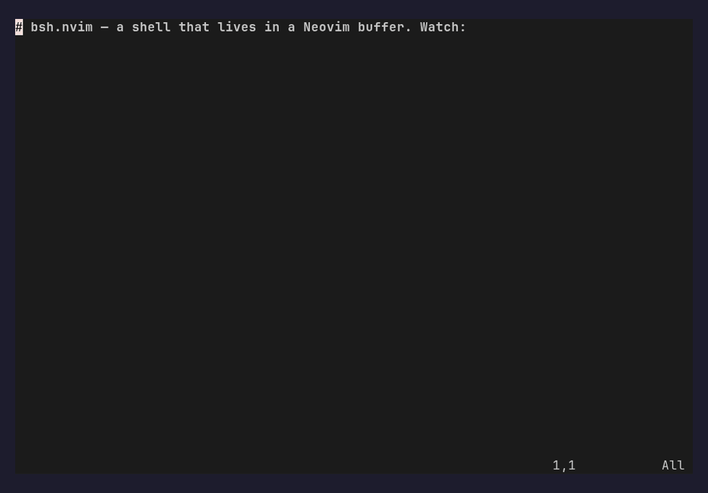

# bsh.nvim

> HIGHLY EXPERIMENTAL, AI WRITTEN, YET TO BE REVIEWED
> and if you already viewing this file in neovim with bsh installed, call :Bsh!

**Buffer SHell**: a shell that lives in a Neovim buffer instead of a terminal.



Point at a `% command`, press `<CR>`, and bsh runs it — writing the result into
an owned `out` fence right below. The whole session is an ordinary, editable
buffer: search it, fold it, edit the output in place, and save it as a file.

## Features

- **Shell cells** — `% cmd` runs in place; output lands in an `out` fence below,
  and re-running rewrites that fence idempotently.
- **Persistent sessions** — `%% cmd` keeps a shell session across cells (cwd,
  env, variables); a plain `%` is one-shot.
- **Remote** — prefix with `user@host` (e.g. `user@host% cmd`,
  `user@host: ~/dir`) to run over ssh; listings and files work remotely too.
- **Redirect & cancel** — `<C-CR>` (or `g<CR>`) sends long output to a scratch
  buffer, leaving a linkable `log` reference; `<C-c>` cancels a running command.
- **Editable output** — it's just buffer text: edit it, search it, fold it, do
  all the nvim magic your heart desires.
- **File explorer** — `: path` lists a directory; add `-T` for a foldable tree;
  `<CR>` drills into folders and opens files (remote paths included).
- **Code fences** — open a block with `lang %` (e.g. `python %`) to run it;
  `lang %%` shares one interpreter session across blocks (python today, more
  language drivers planned).
- **LLM cells** — `>>` asks a headless agent ([pi](https://pi.dev), else `llm`)
  with the previous cell(s) as context (`>` none, `>>` one, `>>>` two, …). Tool
  calls stream in as `⚙ tool arg` lines; pi is read-only unless the `>`s end in
  `!`. A `[name]` before the `>`s picks the pi model (llm: template).
- **Namespace commands** — a dotted name like `demo.reverse` maps to a script
  under `$BSH_HOME`; directories list as navigable menus, and `name!` edits or
  scaffolds the source.
- **Shareable & replayable** — sessions are plain `*.bsh` / `*.bsh.md` files;
  `:BshReplay` re-runs a saved session's cells (typst export planned).

## Motive

I'm frustrated with how uneditable the regular shell interface is, and one must
rely on terminal creators to support any form of intractability with the shell
outputs (highlighting urls, reverse output search, scroll). What if my shell,
was an nvim buffer, where i can search, edit, do all the nvim magic my heart
desires? I want to edit my terminal window however I like, and that's what this
project provides me. (although I do lose... interactive commands, shell
history, and... many other things, alas.. hopefully temporarily.. temporarily..)

(A secondary benefit is that I can share my shell sessions as markdown files (and
hopefully soon, nicely formatted typst documents (pdf, html (maybe), etc))

## Install


```lua
-- lazy.nvim
{ "mktip/bsh.nvim", config = true }   -- or just drop the repo on your runtimepath
```

`bsh` attaches automatically to `*.bsh/*.bsh.md` files. Turn any buffer into a shell on
demand with `:Bsh!`; `:Bsh` opens a fresh scratch one.

> Optional prerequisites (i think, i didn't review it):
> [otter.nvim](https://github.com/jmbuhr/otter.nvim) (for lsp in codeblocks),
> [conform.nvim](https://github.com/stevearc/conform.nvim) (for formatting in codebooks),
> [pi](https://pi.dev) or [llm](https://github.com/simonw/llm) (for LLM cells; see `config.agent`)

## In the pipeline

- [ ] Adding ruby support (and a more generic way of supporting different language drivers)
- [ ] Adding container/jails shell support (even across the seas) and means of adding different transports
- [ ] Just as the markdown-ish support, hopefully <filename>.bsh.typ will be supported too
- [ ] A better way to define and interact with menus/commands. (currently relying on unused return values to communicate certain needs)
- [ ] Reviewing it like a human being (but man is short on free time)

## Credits

[Xiki (seems dead)](https://youtu.be/bUR_eUVcABg), [Plan9](https://en.wikipedia.org/wiki/Plan_9_from_Bell_Labs), [Emacs nerds](somewhere)

## License

[AGPL-3.0](LICENSE).
